<p align="center"></p>

<h1 align="center">TubeGuard</h1>

<p align="center"><b>TizenTube as your Android TV's video app.</b><br>
An Android TV and Google TV app that keeps <a href="https://github.com/reisxd/TizenTubeCobalt">TizenTube Cobalt</a>
installed, up to date and one button away on your remote. No root. No computer needed.</p>

<p align="center">
  <a href="https://github.com/iammosab/tubeguard/releases/latest/download/tubeguard.apk"></a>
  <a href="http://aftv.news/4387448"></a>
</p>

<p align="center">
  <a href="https://github.com/iammosab/tubeguard/releases/latest"></a>
  <a href="https://github.com/iammosab/tubeguard/releases"></a>
  
  
  
</p>

<p align="center">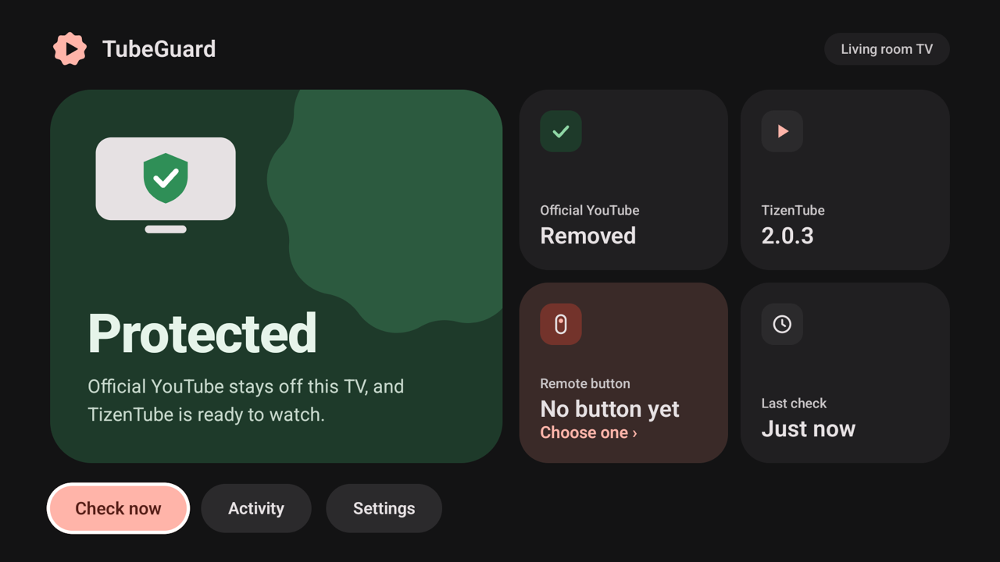</p>

## ✨ Features

<p align="center">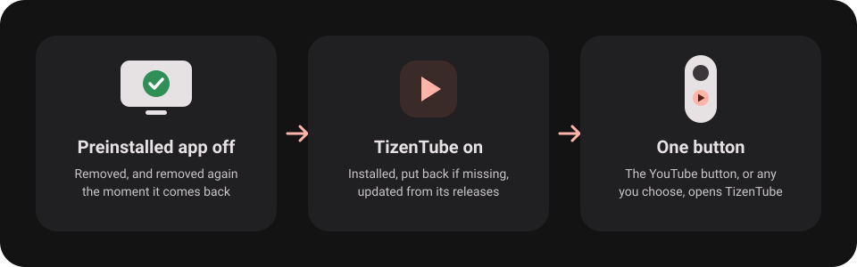</p>

- 🧹 **Clean setup**: removes the TV's preinstalled streaming app and keeps it from coming back after updates.
- ▶️ **TizenTube, always ready**: installs the right build for your TV (32- or 64-bit) and puts it back if it goes
  missing.
- 🔄 **Automatic TizenTube updates**: checks TizenTube's GitHub releases on its own (when you open TubeGuard, after a
  restart and once a day), downloads new versions and installs them, never while you're watching.
- 🎮 **One button**: your remote's video button, or any button you choose, opens TizenTube.
- 🛠️ **Looks after itself**: recovers after updates, restarts and force stops, and tells you when something needs you.
- ↩️ **Undo anytime**: one choice puts the TV back the way it was.

## ⬇️ Download

<p align="left">
  <a href="https://github.com/iammosab/tubeguard/releases/latest/download/tubeguard.apk"></a>
</p>

**Downloader code:** `4387448` · **Short link:** [aftv.news/4387448](http://aftv.news/4387448)

> 💡 Made for Android TV and Google TV. It isn't meant for phones or tablets.

## ❓ How to install

1. Open **[Downloader](https://www.aftvnews.com/downloader/)** on your TV, type **`4387448`** and install the APK.
2. Open **TubeGuard** and choose **Set up — show me how**.
3. Follow the three steps on screen: turn on **Developer options**, turn on **USB debugging**, then press
   **Connect** and choose **Allow** (tick *Always allow*).

That's it. TubeGuard takes care of the rest from now on.

<details>
<summary><b>📸 Setup, step by step</b></summary>
<br>

| 1 · Start | 2 · Developer options |
|---|---|
| 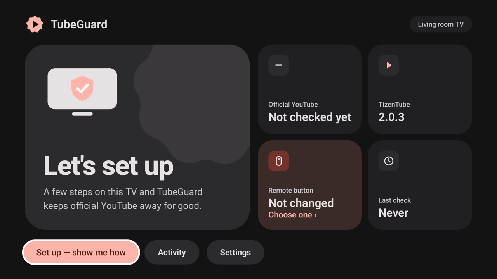 | 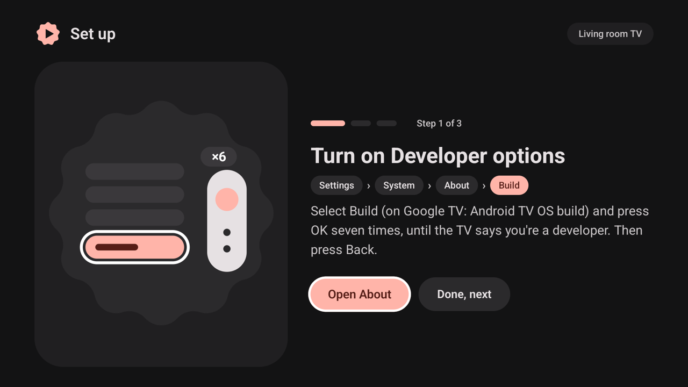 |

| 3 · USB debugging | 4 · Connect |
|---|---|
| 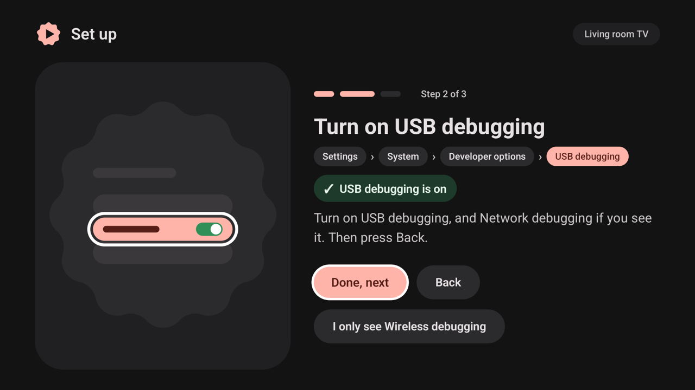 | 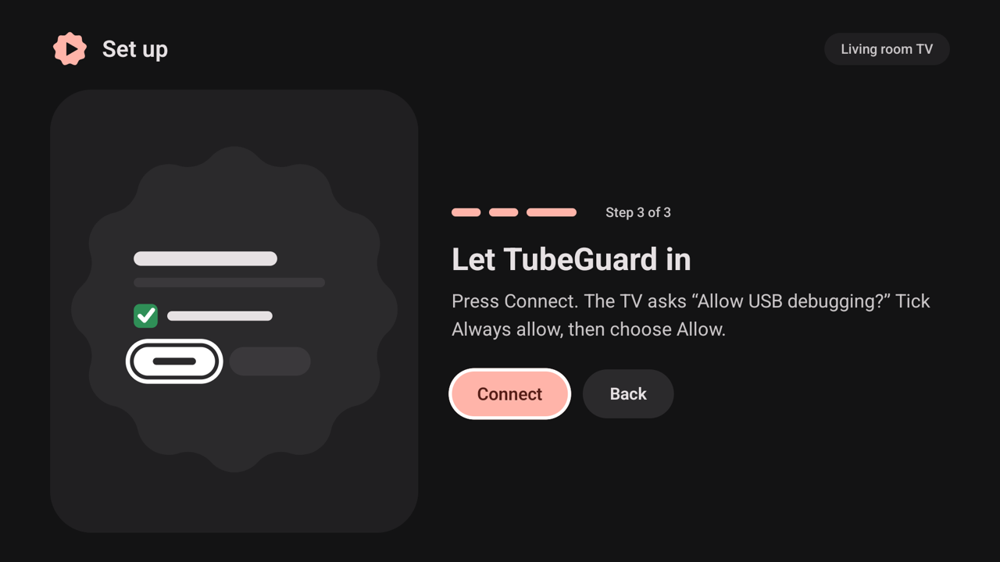 |

| 5 · Allow | 6 · All set |
|---|---|
| 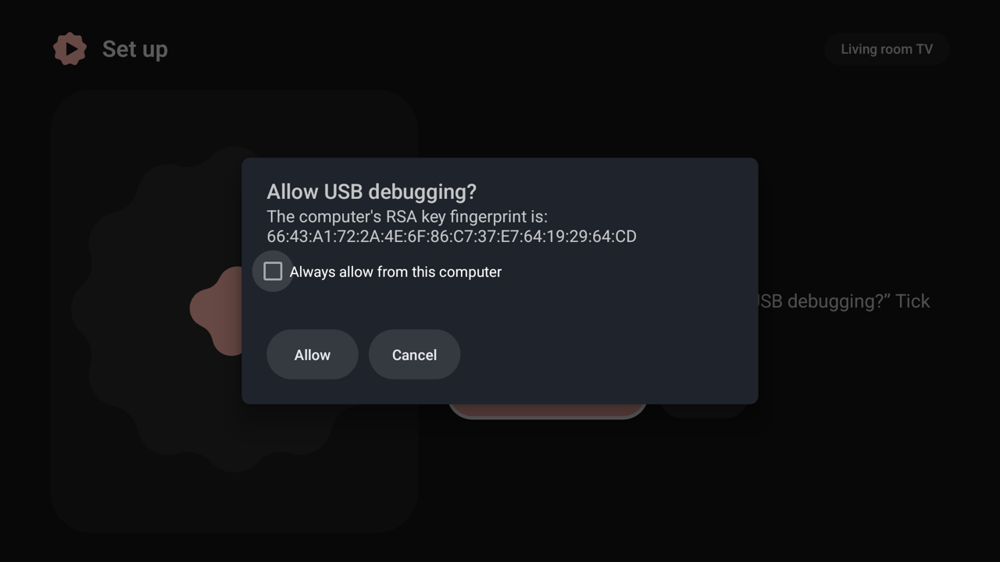 | 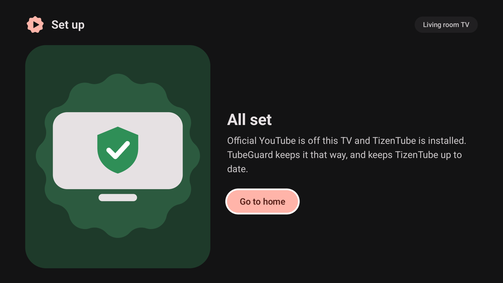 |

**Step 2:** **Open About** jumps to the right page. Select **Build** (on Google TV: *Android TV OS build*) and press
**OK** seven times, then **Back**.
**Step 3:** **Open Developer options**, turn on **USB debugging**, then **Back**. Only see *Wireless debugging*?
Choose **I only see Wireless debugging**.
</details>

<details>
<summary><b>🎮 Choose a button, Settings and Activity</b></summary>
<br>

| Choose a button | Settings | Activity |
|---|---|---|
| 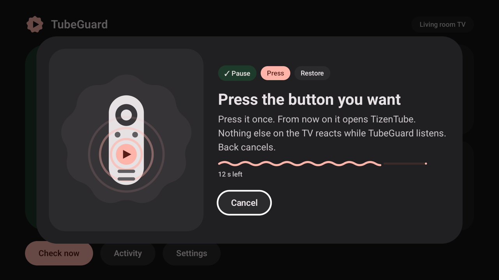 | 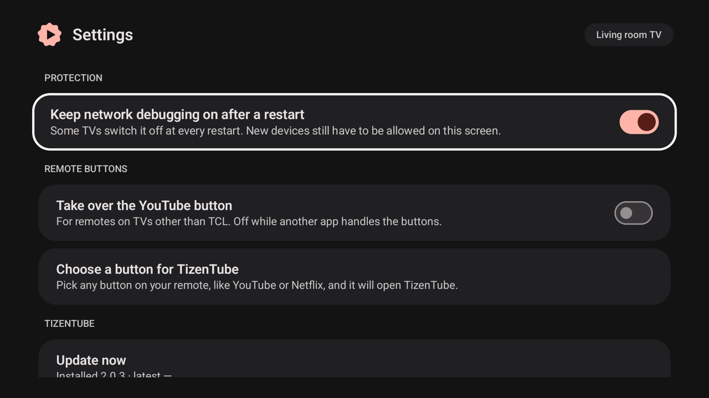 | 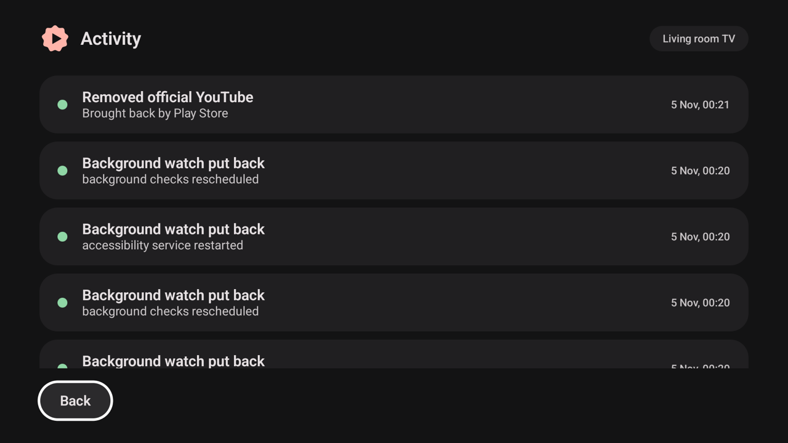 |

On TCL TVs the video button already opens TizenTube. To use another button, select the **Remote button** tile on
the home screen and press the button you want.
</details>

## 🧪 Tested devices

| Device | Android | Result |
|---|---|---|
| **TCL Smart TV Pro** (G08, Google TV, 32-bit ARM) | 14 | ✅ Full setup, app removal, TizenTube install and updates, remote button, Undo |
| **Google TV emulator** (64-bit ARM) | 14 | ✅ Full setup, app removal, 64-bit TizenTube install, Undo |

Other Android TV / Google TV devices should work too. Tried one? Tell us in
[issues](https://github.com/iammosab/tubeguard/issues).

## 💬 FAQ

<details>
<summary><b>Do I need root or a computer?</b></summary>

No. TubeGuard uses the TV's own debugging connection, which you allow once on the TV.
</details>

<details>
<summary><b>Does it update TizenTube by itself?</b></summary>

Yes. TubeGuard checks for new TizenTube releases when you open it, after the TV restarts and once a day. When there's a
new version it downloads the right build, checks it and installs it, without asking. It waits if you're watching
TizenTube at that moment. You can also check right away with **Update now** in Settings.
</details>

<details>
<summary><b>Which app does it remove?</b></summary>

The TV's preinstalled video streaming app (`com.google.android.youtube.tv`). It's removed for your user only, so
**Undo** in Settings can bring it back at any time.
</details>

<details>
<summary><b>The button opens another app first.</b></summary>

Another app (for example a launcher with its own button settings) is bound to the same button. TubeGuard brings
TizenTube back to the front and names that app on the home screen, so you can change its button setting.
</details>

<details>
<summary><b>Is "Allow USB debugging" safe?</b></summary>

It lets TubeGuard act on the TV the way a computer with `adb` would. Any other device still has to be approved on
the TV screen, and you can turn debugging off at any time.
</details>

## 🔧 Build from source

```sh
./gradlew :app:testDebugUnitTest :app:assembleRelease
```

Needs JDK 17+ and the Android SDK (platform 37). Release signing reads `keystore.properties`.

---

<sub>TubeGuard is an independent project, not affiliated with Google or TCL. TizenTube Cobalt is a separate project
by its own authors.</sub>
